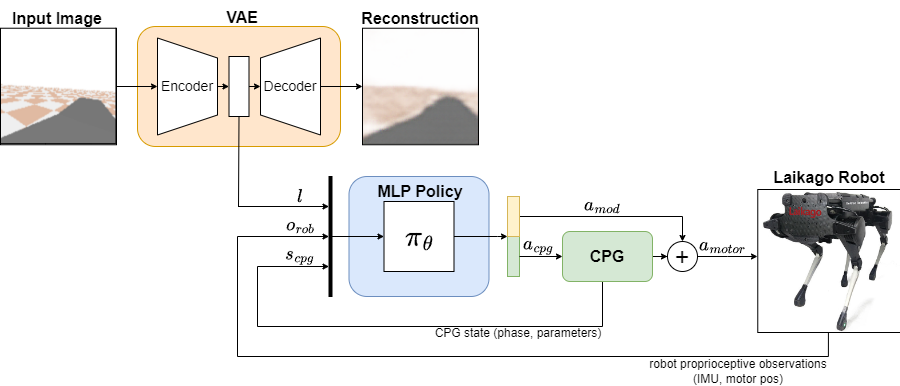
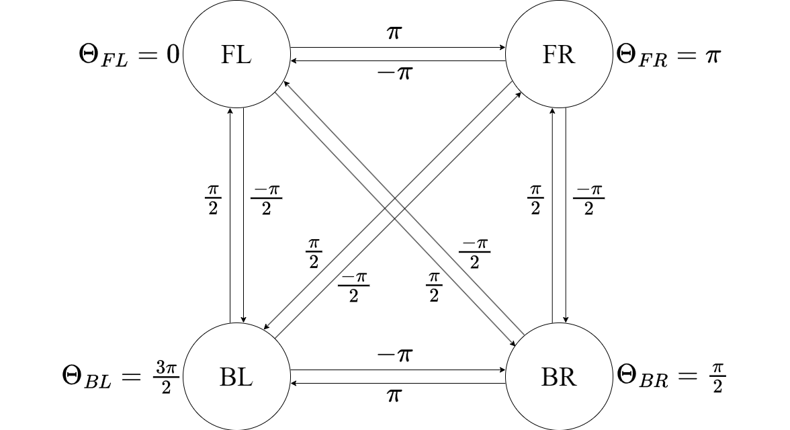
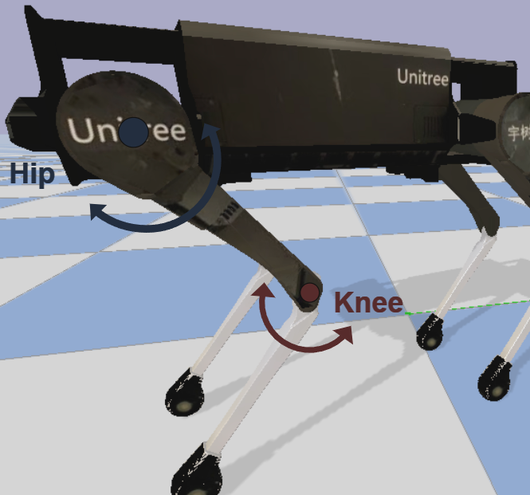
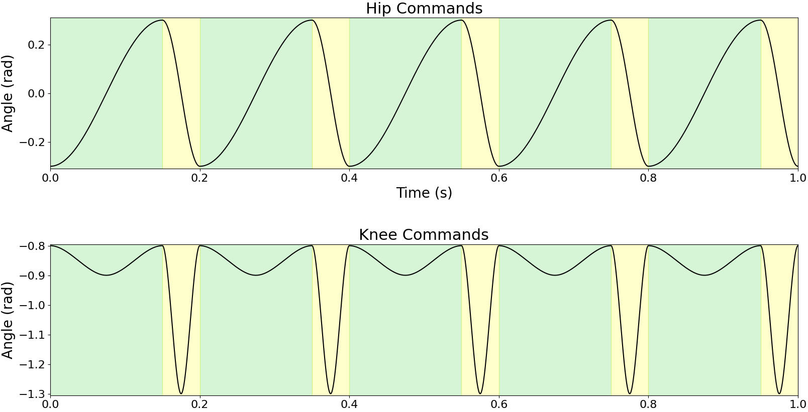
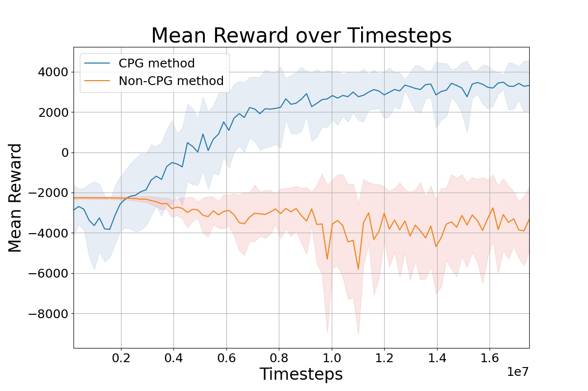

# Four-Legged Gait Control via the Fusion of Computer Vision and Reinforcement Learning

Reference implementation of the VAE-CPG architecture: a quadruped gait controller that combines a
pretrained Variational Autoencoder (VAE) for visual terrain representation, a parametrized Central
Pattern Generator (CPG) for periodic leg trajectories, and a Proximal Policy Optimization (PPO)
policy that adapts the CPG parameters and applies residual motor corrections.

The controller is trained and evaluated on the Unitree Laikago robot inside the PyBullet simulator,
on goal-reaching tasks in interior scenes designed to resemble construction sites, both with and
without obstacles.

This repository contains the code developed for the Memoria of Ignacio Dassori for the degree of
Electrical Engineering, Universidad de Chile, later extended into the paper *Four-Legged Gait
Control via the Fusion of Computer Vision and Reinforcement Learning* (I. Dassori, M. Adams,
J. Vasquez).

---

## 1. Method

### 1.1 Pipeline



*The camera image is encoded by the VAE into a latent vector `l`. The MLP policy receives `l`, the
proprioceptive observations `o_rob` and the CPG state `s_cpg`, and outputs CPG parameters `a_cpg`
together with residual corrections `a_mod`. The CPG converts its parameters into periodic joint
trajectories, and the sum `a_motor` is sent to the robot.*

At every simulation step the controller executes the following sequence:

1. An RGB image (512x512) is rendered from a camera attached to the robot base, pointing along the
   robot's forward axis. The image is encoded by the VAE encoder into a latent vector `z`
   (32 dimensions for the house environments, 16 for the slope environments). The latent vector is
   recomputed every 50 simulation steps and held constant in between.
2. The policy network receives the concatenation of the latent vector, the robot proprioceptive
   state (orientation, angular velocities, motor positions), the current CPG phase and parameters,
   and, in the obstacle environment, the robot and goal planar positions.
3. The policy outputs CPG parameters and one residual correction per actuated motor.
4. The CPG integrates its phase, moves its parameters towards the commanded values with a
   first-order filter, and produces target angles for the hip and knee motors.
5. Target angle plus residual correction is sent to each motor in position control mode.

The simulation runs at 500 Hz (`p.setTimeStep(1./500)`). One environment step corresponds to one
simulation step.

### 1.2 Central Pattern Generator

The CPG is implemented in `utils/cpg.py`. Four coupled oscillators, one per leg, share a common
frequency `f` and are initialized with fixed phase offsets `[0, pi, pi/2, 3*pi/2]`, which produce a
diagonal-sequence walking gait with a 90 degree shift between consecutive legs.

<p align="center">
  
  &nbsp;&nbsp;
  
</p>

<p align="center"><em>Left: phase relationship between the four oscillators, front left, front
right, back left and back right. Right: the two actuated joints per leg in the sagittal plane.</em></p>

Phase integration:

```
Theta_i <- (Theta_i + 2*pi*f*dt) mod 2*pi
```

Parameters are not applied instantaneously. Each parameter follows the policy command through a
proportional update with gain `gamma`, which enforces smooth transitions between gaits:

```
p <- p + (p_command - p) * gamma * dt
```

The duty factor `d` splits the cycle into stance and swing. The hip phase is stretched accordingly:

```
phi_h = phi / (2*d)                                if phi <  2*pi*d
phi_h = (phi + 2*pi*(1 - 2*d)) / (2*(1 - d))       otherwise
```

The hip target angle is a cosine of amplitude `A_h` around an offset `off_h`:

```
theta_h = A_h * cos(phi_h) + off_h
```

The knee follows a piecewise cubic profile `g`, scaled by a stage-dependent amplitude
(`A_k_st` during stance, `A_k_sw` during swing) and shifted by `off_k`:

```
theta' = 2 * ((phi_k / (2*pi)) mod 0.5)

g = -16*theta'^3 + 12*theta'^2                          if theta' < 0.5
g = 16*(theta'-0.5)^3 - 12*(theta'-0.5)^2 + 1           otherwise

theta_k = A_k * g + off_k
```



*Hip and knee commands over one second for `f = 4`, `d = 0.75`, `A_h = 0.3`, `A_k_st = 0.1`,
`A_k_sw = 0.5`. Green marks the stance phase and yellow the swing phase. The knee stays close to
extension during stance and contracts sharply to lift the leg during swing.*

Three CPG variants are provided:

| Class | Adaptive parameters | Used by |
| --- | --- | --- |
| `CPG` | `f`, `A_h`, `A_k_st`, `A_k_sw`, `d`, `off_h`, `off_k` | plain and slope environments, `houseEnv` |
| `CPG_house` | `A_h`, `A_k_st`, `A_k_sw`, `d`, plus four coronal joint angles; `f` fixed at 3.0 Hz | `houseEnvV2` |
| `CPG_houseV2` | `A_h`, `A_k_st`, `A_k_sw`, `d`; `f` fixed at 4.0 Hz, offsets fixed | `houseEnvV3`, `houseObstaclesEnv` |

Only the eight sagittal joints (hip and knee of each leg, PyBullet joint indices 1, 2, 5, 6, 9, 10,
13, 14) are driven by the CPG in the final architecture. The four coronal joints (indices 0, 4, 8,
12) are held at zero.

`utils/cpg_test.py` is a standalone script that plots the hip and knee command profiles for a fixed
parameter set, useful for inspecting the effect of each parameter without running the simulator.

### 1.3 Variational Autoencoder

The VAE is defined in `VAE/modules.py`. The class used by the house environments is `VAE_512`, a
convolutional encoder-decoder built from a configurable list of channel widths. Each encoder block
is `Conv2d(kernel 4, stride 2, padding 1)` followed by `BatchNorm2d`, `LeakyReLU` and `Dropout(0.1)`;
the decoder mirrors this with `ConvTranspose2d` and a `Tanh` or `Sigmoid` output layer. Two fully
connected heads produce `mu` and `logvar`, and the latent vector is sampled with the
reparameterization trick.

The training objective is the sum of a summed-MSE reconstruction term and a KL divergence term
weighted by `kld_weight`:

```
loss = MSE(x_hat, x) + kld_weight * KL(q(z|x) || N(0, I))
```

At inference time the environments use only the encoder, and take `mu` as the latent command
(no sampling), with the model in `eval()` mode and gradients disabled.

`modules.py` also contains earlier variants kept for reference: `VAE` (fixed architecture),
`DeepAutoencoder` and `AutoencoderFC`, along with the `DepthDataset`, `RGBDataset` and `HouseDataset`
loaders.

### 1.4 Policy, observation and action spaces

The policy is a two-layer fully connected MLP trained with PPO from Stable-Baselines3
(`MlpPolicy`, `net_arch = dict(pi=[2048, 2048], vf=[2048, 2048])`, ReLU activation).

For the final architecture (`houseObstaclesEnv`), the raw observation vector has 54 components:

| Block | Size | Content |
| --- | --- | --- |
| Position | 3 | Robot x, robot y, goal x (goal y is fixed at the opposite wall) |
| Orientation | 3 | Roll, pitch, yaw |
| Angular velocity | 3 | Base angular velocity |
| Motor positions | 8 | Hip and knee angles |
| CPG state | 5 | Phase of the first oscillator, `A_h`, `A_k_st`, `A_k_sw`, `d` |
| Latent | 32 | VAE encoding of the current camera image |

Each component is normalized to `[0, 1]` inside the agent using the fixed bounds `lower_obs` and
`upper_obs`, and then normalized again by the running statistics of `VecNormalize` during training.

The action vector has 12 components, all in `[0, 1]`, rescaled inside the agent to:

| Action | Range |
| --- | --- |
| Hip amplitude `A_h` | `[0.0, 0.5]` |
| Stance knee amplitude `A_k_st` | `[0.0, 0.2]` |
| Swing knee amplitude `A_k_sw` | `[0.0, 0.5]` |
| Duty factor `d` | `[0.5, 0.95]` |
| Residual correction (x8) | `[-0.1, 0.1]` rad |

Environments that expose the frequency to the policy additionally map the normalized frequency
action into `freq_range` (default `[1.5, 5.0]` Hz).

### 1.5 Reward

The reward implemented in `agents/laikago_house_obstacles.py` is a weighted sum of six terms. `w` is
the fraction of the initial robot-to-goal distance already covered, so the objective transitions
from rewarding forward walking to rewarding motion towards the goal as the episode progresses.

| Term | Definition |
| --- | --- |
| `r1` | Forward velocity, capped at 1 m/s |
| `r2` | Velocity projected onto the goal direction, capped at 1 m/s, clipped to non-positive values when the velocity direction deviates from the heading by more than 0.5 rad |
| `r3` | Terminal term: `+1000` if the goal is reached, `-2000 + 2000*w` otherwise |
| `r4` | Instability penalty, the sum of the absolute roll and pitch angular velocities |
| `r5` | Squared angular difference between the heading and the goal direction |
| `r6` | Obstacle proximity penalty, `sum(max(1 - distance_i, 0))` over all obstacles |

```
R = max(1 - 2w, 0) * r1 + min(2w, 1) * r2 + r3 - 0.3 * r4 - r5 - 5 * r6
```

An episode terminates when the robot falls (roll or pitch beyond 0.5 rad), reaches within 2.0 m of
the goal, approaches a wall, turns more than 90 degrees away from the goal direction, contacts an
obstacle, or exceeds 8000 steps.

The reward for the obstacle-free variant (`agents/laikago_houseV3.py`) drops `r6`, weights `r5` by
3, uses a time-dependent terminal penalty and terminates at 45 degrees of heading error.

### 1.6 Scene generation

`utils/spawn_objects.py` (`SpawnManager`) builds the scene at every reset:

- The room mesh `utils/objects/house.obj` is loaded as a static multibody.
- The room is discretized into a 10x10 occupancy grid used to place objects without overlaps.
- The goal is a red box placed against the opposite wall at a randomized lateral position, drawn
  from the cell set `[1, 2, 3, 6, 7, 8]` with a random sway offset.
- During training the robot always spawns at `[0, -4.5]` facing the goal. Setting
  `image_extraction=True` enables randomized spawn positions along three walls with a random yaw
  perturbation, used when collecting the VAE dataset.
- Obstacles are drawn from the meshes in `utils/objects` (traffic cone, barricade, cement bags,
  ladder, pallet), placed on free grid cells with a random orientation and a small positional
  jitter, up to `max_obj`. In the current state of the file the object type is forced to the traffic
  cone.

`utils/ramp.py` provides the terrain generators used by the earlier slope experiments: `Ramp`
concatenates randomly pitched ramp segments (between 5 and 10 degrees) from the URDF files in
`utils/urdf`, and `Bridge` loads a single inclined plane.

---

## 2. Repository structure

```
.
├── agents/                  Robot-side logic: action application, observation, reward, termination
├── environments/            gym.Env wrappers and the environment registry
├── VAE/                     VAE architectures, training script, pretrained weights
│   ├── modules.py
│   ├── train_vae.py
│   ├── get_best.py          Ranks trained VAEs by validation loss
│   ├── results/             Weights for the slope-environment VAEs
│   └── results_house/       Weights for the house-environment VAEs
├── utils/
│   ├── cpg.py               CPG implementations
│   ├── cpg_test.py          Standalone CPG trajectory plot
│   ├── callbacks.py         Model selection callbacks and learning-rate schedule
│   ├── ramp.py              Slope and bridge terrain generators
│   ├── spawn_objects.py     Scene, goal and obstacle placement
│   ├── objects/             OBJ/MTL meshes for the room and the obstacles
│   └── urdf/                Ramp and bridge URDFs
├── train.py                 PPO training entry point
├── main.py                  Evaluation and trajectory plotting entry point
├── online_image_extraction.py   Dataset collection by rolling out a trained policy
├── image_extraction.py      Interactive camera placement tool and manual capture
├── plot_csv.py              Reward curves from exported TensorBoard CSVs, VAE loss curves
├── plot_reward_curve.py     Reward curve from the per-worker monitor CSVs
├── plot_histograms.py       Final-position histograms across methods
├── results/                 Trained models, plain and slope experiments
├── results_new_rew/         Trained models, plain and slope, revised reward
├── results_house/           Trained models, house experiments
├── csv/                     Exported TensorBoard reward curves
├── performance/             Archived evaluation arrays (final position, finish time)
└── images/                  Captured camera frames used to train the VAEs
```

### 2.1 Agents

Each agent class owns the robot instance and implements the four methods the environment calls:

- `spawn(...)` loads `laikago/laikago_toes.urdf` from `pybullet_data` at the requested pose.
- `apply_action(action)` rescales the normalized action, updates the CPG, and writes position
  targets to the motors with a maximum force of 30 N·m.
- `get_observation(timestep, encoder)` assembles and normalizes the observation vector, refreshing
  the VAE latent every 50 steps.
- `calculate_reward(done, timestep)` and `is_done(timestep)` implement the reward and the
  termination conditions.

`get_image()` builds the camera view matrix from the robot pose by composing roll, pitch and yaw
rotation matrices, offsets the camera along the resulting forward axis, and renders a 512x512 image
with a 70 degree field of view.

### 2.2 Environments

Environments are thin `gym.Env` wrappers. They hold the PyBullet client, own the VAE encoder,
delegate the physics-facing logic to the agent, and rebuild the scene on `reset()`. Constructor
arguments common to the house environments:

| Argument | Meaning |
| --- | --- |
| `mode` | `0` connects PyBullet in DIRECT mode (headless), `1` in GUI mode |
| `freq_range` | Frequency range the normalized frequency action is mapped into |
| `gamma` | Proportional gain of the CPG parameter filter |
| `vae_path` | Directory containing `config.json` and `best_model.pt` for the encoder |
| `spawn_objects` | Whether obstacles are placed in the scene |
| `env_id`, `log_dir` | Worker index and directory for the per-worker monitor CSV |

All environments are registered in `environments/__init__.py`, so importing any module from the
`environments` package makes every id available to `gym.make`.

| Registered id | Module | Action dim | Observation dim | Description |
| --- | --- | --- | --- | --- |
| `ppo_plainEnv` | `ppo_plain.py` | 8 | 12 | Flat ground, direct joint position control, no CPG |
| `cpg_plainEnv` | `cpg_plain.py` | 7 | 20 | Flat ground, CPG parameters only, no residuals |
| `modulating_plainEnv` | `modulating_plain.py` | 15 | 20 | Flat ground, CPG parameters plus residual corrections |
| `ppo_slopeEnv` | `ppo_slope.py` | 8 | 28 | Ramp terrain, direct joint control, 16-dim latent |
| `cpg_slopeEnv` | `cpg_slope.py` | 7 | 36 | Ramp terrain, CPG parameters only, 16-dim latent |
| `modulating_slopeEnv` | `modulating_slope.py` | 15 | 36 | Ramp terrain, CPG plus residuals, 16-dim latent |
| `houseEnv` | `house.py` | 15 | 54 | Interior room, no obstacles, full CPG parameter set |
| `houseEnvV2` | `houseV2.py` | 16 | 55 | Adds coronal joints to the action space, fixed frequency |
| `houseEnvV3` | `houseV3.py` | 12 | 51 | Fixed frequency, coronal joints held at zero |
| `housePPOEnv` | `house_ppo.py` | 12 | 50 | Interior room baseline, direct joint control, no CPG |
| `houseObstaclesEnv` | `house_obstacles.py` | 12 | 54 | Final architecture: obstacles, goal-relative observations |

The two comparisons reported in the paper are `houseEnvV3` against `housePPOEnv` (no obstacles) and
`houseObstaclesEnv` against the same baseline with obstacles enabled.

---

## 3. Installation

The code targets the pre-Gymnasium API: environments subclass `gym.Env` and `step()` returns the
four-value tuple `(obs, reward, done, info)`. It therefore requires the `gym` package and
Stable-Baselines3 1.x. Stable-Baselines3 2.x, which expects Gymnasium, is not compatible without
modifications.

```bash
python -m venv .venv
source .venv/bin/activate

pip install "stable-baselines3<2.0" "gym==0.21.0" pybullet
pip install torch torchvision
pip install numpy pandas matplotlib seaborn opencv-python pillow tensorboard
```

A CUDA-capable GPU is assumed by `train.py` (`device="cuda"`). The experiments in the paper were run
on an NVIDIA RTX 4070.

All scripts use paths relative to the repository root and must be run from it.

---

## 4. Usage

### 4.1 Collecting the VAE dataset

Two capture routes are available.

`online_image_extraction.py` rolls out an already trained policy and saves a frame every 300 steps
to `images/house_rgb_512`. Set `version` at the top of the file to the results directory of the
policy used to drive the robot.

```bash
python online_image_extraction.py
```

`image_extraction.py` opens a PyBullet GUI with debug sliders for the view and projection matrices,
displays the resulting camera feed through OpenCV, and writes the current frame on `s` and exits on
`q`. It is the tool used to choose the camera placement that the agents reproduce in `get_image()`.

```bash
python image_extraction.py
```

The paper's VAE was trained on a dataset of over 2000 images. Note that `.jpg` and `.png` files are
excluded by `.gitignore`, so the datasets themselves are not tracked.

### 4.2 Training the VAE

Edit the hyperparameter block at the top of `VAE/train_vae.py` (`log_dir`, `latent_dim`, `layers`,
`lr`, `kld_weight`, `batch_size`, `output_activation`), set `mode = "training"`, and run:

```bash
python VAE/train_vae.py
```

The script trains for up to 300 epochs with gradient clipping at 0.5, evaluates on a held-out split
after every epoch, saves `best_model.pt` whenever the validation loss improves, and stops early
after 20 epochs without improvement. It then writes `config.json` with the hyperparameters and the
best validation loss, and displays the training and validation loss curves.

With `mode = "eval"` the script loads `best_model.pt` and displays input and reconstruction pairs
for the validation set.

`VAE/get_best.py` walks the subdirectories of a results folder and prints the models ranked by the
`lowest_loss` field of their `config.json`.

Pretrained encoders are included:

| Directory | Latent dim | Channels | Notes |
| --- | --- | --- | --- |
| `VAE/results_house/dropout11` | 32 | `[16, 32, 64, 128, 256]` | Encoder used by the house experiments, lowest validation loss of the group |
| `VAE/results_house/{blue12, dropout2, droput3, exp9}` | 32 | `[16, 32, 64, 128, 256]` | Alternative house runs |
| `VAE/results/lr5e-3_bs16_kld0.00025` | 16 | `[32, 64, 128, 256, 512]` | Encoder used by the slope experiments, lowest validation loss of the group |
| `VAE/results/lr*` | 16 | `[32, 64, 128, 256, 512]` | Learning rate, batch size and KL weight sweep |

The `lowest_loss` values in `config.json` are comparable within a group but not across groups, since
the two sets were trained on different datasets and splits.

### 4.3 Training a policy

Edit the configuration block at the top of `train.py`:

```python
environment     = 'houseObstaclesEnv'    # registered environment id
experiment_name = 'test5'                # subdirectory under results_house/<environment>/
num_envs        = 6                      # parallel simulation workers
use_vae         = True
freq_range      = [1.5, 5.0]
gamma           = 10.0
vae             = 'dropout11'            # subdirectory of VAE/results_house
```

Then run:

```bash
python train.py
```

The script creates `results_house/<environment>/<experiment_name>/`, launches `num_envs` workers in
a `SubprocVecEnv`, wraps them in `VecNormalize` (observation and reward normalization, observation
clipping at 10), writes `config.json` with the full configuration, and trains with
`MonitorCallback`.

`MonitorCallback` reads the per-worker `monitor_*.csv` files at the end of every rollout, computes
the mean episode reward across workers for the current update, and saves both `best_model.zip` and
`vec_normalize.pkl` whenever that mean improves. Training stops early after 20 consecutive rollouts
without improvement.

Important: the per-worker CSV logging is driven by the `self.train` flag inside each house
environment, which is currently set to `False` in `house.py`, `houseV2.py`, `houseV3.py` and
`house_obstacles.py`. Set it to `True` before training, otherwise the monitor files are never
created and the callback cannot compute the mean reward.

Alternative callbacks are available in `utils/callbacks.py`: `SaveOnBestTrainingRewardCallback`
(based on the Stable-Baselines3 `Monitor` wrapper output) and `SaveBestModelCallback` (based on the
model's internal episode buffer). `linear_schedule(initial_value, final_value)` returns a schedule
callable that can be passed as `learning_rate`.

### 4.4 Evaluating a trained policy

Set `version` in `main.py` to a directory under `results_house/`, then run:

```bash
python main.py
```

The script reads `config.json`, rebuilds the environment in GUI mode (`mode=1`), restores the
`VecNormalize` statistics with `training=False` and `norm_reward=False`, loads `best_model.zip`, and
runs the policy while recording positions, orientations, per-step rewards, CPG parameters and motor
positions. On episode termination it prints the episode return. At the end it plots the robot's
XY trajectory together with the goal box and the initial and final robot poses, reproducing the
trajectory figures of the paper. Commented blocks in the same file plot the CPG parameters and the
motor positions over time.

### 4.5 Plotting

| Script | Input | Output |
| --- | --- | --- |
| `plot_reward_curve.py` | `results_house/<env>/<run>/monitor_*.csv` | Mean reward per update, aggregated across parallel workers |
| `plot_csv.py` | `csv/<subdir>/*.csv` exported from TensorBoard | Reward curves for the PPO, PPO + CPG and PPO + CPG + modulation methods |
| `plot_csv.py` (`plot_np`) | `train_loss.npy`, `eval_loss.npy` | VAE training and validation loss curves |
| `plot_histograms.py` | `performance/<subdir>/*.npy` | Final-position histograms for the three methods |

Each script has its input directory hardcoded in the `__main__` block.

---

## 5. Stored experiments

Trained runs are stored as `<results dir>/<environment>/<experiment name>/` and contain:

| File | Content |
| --- | --- |
| `best_model.zip` | Stable-Baselines3 PPO checkpoint with the highest mean reward |
| `vec_normalize.pkl` | Observation and reward normalization statistics, required to load the model |
| `config.json` | Environment id, VAE path, hyperparameters, frequency range, CPG gain |
| `monitor.csv` or `monitor_*.csv` | Episode returns and lengths, single file or one per worker |
| `PPO_1/events.out.tfevents.*` | TensorBoard logs, present for some runs |

- `results/` holds the plain and slope experiments across the three strategies
  (`ppo_*`, `cpg_*`, `modulating_*`).
- `results_new_rew/` holds plain and slope runs with the revised reward function.
- `results_house/` holds the house experiments, including `houseEnvV3/test4`.
- `performance/` holds archived evaluation arrays, one pair per method and setting, storing the
  final position reached and the completion time over a batch of trials. These arrays are consumed
  by `plot_histograms.py`. The script that produced them is no longer part of the repository.
- `csv/` holds reward curves exported from TensorBoard, grouped by experiment
  (`plain_hyperparameters`, `slope_even_bigger`, `slope_walk_straight_long`, `diff_freq`).

---

## 6. Hyperparameters

Values used by the final configuration in `train.py`, with the values reported in the paper where
they differ.

### PPO

| Parameter | Value in `train.py` | Value in the paper |
| --- | --- | --- |
| Rollout buffer per worker (`n_steps`) | 32768 | 8192 x 6 |
| Mini-batch size | 4096 | 1024 x 6 |
| Parallel workers | 6 | 6 |
| Learning rate | 0.0003 | 0.0003 |
| Discount factor | 0.99 (SB3 default) | 0.99 |
| Clip range | 0.2 (SB3 default) | 0.2 |
| Policy and value network | `[2048, 2048]` | `[2048, 1024]` |
| Activation | ReLU | ReLU |
| Total timesteps | 30,000,000 | 25,000,000 |
| Max episode length | 8000 steps | 8000 |

### VAE

| Parameter | Value |
| --- | --- |
| Input | 512x512 RGB |
| Latent dimension | 32 |
| Channels | `[16, 32, 64, 128, 256]` |
| Activation | LeakyReLU, `Tanh` output |
| Learning rate | 0.0001 |
| KL divergence weight | 0.00025 |
| Batch size | 4 |
| Epochs | up to 300, early stopping after 20 |
| Training images | 2048 |
| Augmentation | Random horizontal and vertical flips |

### CPG

| Parameter | Value |
| --- | --- |
| Frequency | Fixed at 4.0 Hz in `CPG_houseV2` (the paper reports 3 Hz) |
| Frequency range when adaptive | `[1.5, 5.0]` Hz |
| Parameter filter gain `gamma` | 10.0 |
| Initial phase offsets | `[0, pi, pi/2, 3*pi/2]` |
| Motor force limit | 30 N·m |

---

## 7. Results reported in the paper

- In the obstacle-free goal-reaching task, the VAE-CPG architecture converges after approximately
  15 million timesteps and over 3500 episodes, and reaches the goal from all tested goal positions
  along the opposite wall, tracing smooth steering curves in the XY plane. The baseline that applies
  PPO directly to the motor angles does not learn a meaningful policy within the same training
  budget.

  

  *Mean reward with standard deviation in the no-obstacle goal-reaching task, comparing the CPG and
  non-CPG strategies.*
- In the obstacle task, the VAE-CPG architecture increases reward steadily throughout training and
  produces trajectories that deviate around the obstacles before reaching the goal. The baseline
  again fails to improve.
- Restricting the action space to CPG parameters plus small residuals is what makes the difference:
  it shrinks the search space, enforces coordinated periodic leg motion from the first episode, and
  guarantees smooth transitions between gaits.

---

## 8. Implementation notes and known limitations

- Entry-point scripts are configured by editing constants at the top of the file rather than through
  command-line arguments.
- `main.py`, `plot_reward_curve.py` and `online_image_extraction.py` have their results directory
  prefix hardcoded (`results_house/` or `results/`). Change the prefix when evaluating a run stored
  in a different directory.
- The default `vae_path` values in `environments/__init__.py` are bare directory names
  (`dropout11`, `lr5e-3_bs16_kld0.00025`) rather than paths relative to the repository root. Pass
  `vae_path` explicitly to `gym.make`, as `train.py` and `main.py` do.
- `self.train` is hardcoded to `False` in most house environments and must be enabled for training
  runs. See section 4.3.
- `spawn_objects.py` in the repository root is an earlier version of `utils/spawn_objects.py`. Only
  the copy under `utils/` is imported by the environments.
- The VAE latent is refreshed every 50 simulation steps in all agents. The paper describes a
  10-step refresh interval.
- `SpawnManager.main_loop` currently forces the traffic cone as the only obstacle type; the branch
  that samples among the five mesh types is commented out. `max_obj` is 5, while the paper limits
  episodes to three obstacles.
- `plot_csv.plot_csv` builds its dataframes through `exec` and swaps the first two entries of the
  directory listing to fix the legend order, so it assumes a specific number and ordering of files
  in the target directory.
- The agents under `agents/` and the environments under `environments/` are versioned copies rather
  than a single parametrized implementation. The final architecture corresponds to
  `house_obstacles.py` and `laikago_house_obstacles.py`; the remaining files are retained because
  they produced the comparison results stored under `results/` and `performance/`.

---

## 9. Citation

```bibtex
@article{dassori2024fourlegged,
  title  = {Four-Legged Gait Control via the Fusion of Computer Vision and Reinforcement Learning},
  author = {Dassori, Ignacio and Adams, Martin and Vasquez, Jorge},
  note   = {Universidad de Chile and Carnegie Mellon University}
}
```
